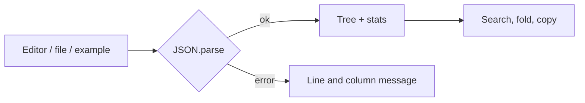

<p align="center"></p>

<p align="center">
  
  
  
</p>

**JSONLens** is a small, fast JSON workbench. Paste something messy, hit Format, and get a tidy document plus a tree you can fold, search and copy from. No build step, no accounts, no uploads. Your data never leaves the page.

## What you can do

| Action | How |
| --- | --- |
| Format or minify | Toolbar buttons, or `Ctrl/Cmd + Enter` to format |
| Validate | Happens as you type, with line and column when the parser reports one |
| Explore | Collapsible tree with colored keys, strings, numbers, booleans and nulls |
| Search | Filters the tree to matching keys or values and highlights them |
| Copy | Whole document from the toolbar, or any single value from the tree |
| Import | File picker or drag a `.json` file onto the page |
| Stats | Keys, objects, arrays, values and approximate size |
| Themes | Dark and light, remembered between visits |

## Run it

```bash
git clone https://github.com/CyberLoop-dev/jsonlens.git
cd jsonlens
# open index.html in your browser, or serve the folder:
python3 -m http.server 8000
```

There is nothing to install.

## How it fits together



## Project structure

```text
jsonlens/
├── index.html   # layout and toolbar
├── styles.css   # theme tokens and components
├── app.js       # parsing, tree, search, stats
└── assets/      # logo and README banner
```

## Known limitations

- The editor is a plain textarea, so syntax coloring lives in the inspector tree rather than the input.
- Very large files (tens of MB) will feel slow because the whole tree is built in the DOM.
- Numbers beyond JavaScript's safe integer range lose precision, as with any `JSON.parse`.

## Ideas for later

- Syntax-highlighted editor overlay
- JSON path display and copy
- Virtualized tree for huge documents

## Contributing

Issues and pull requests are welcome. Keep it dependency-free and keyboard accessible.

## License

[MIT](LICENSE)
